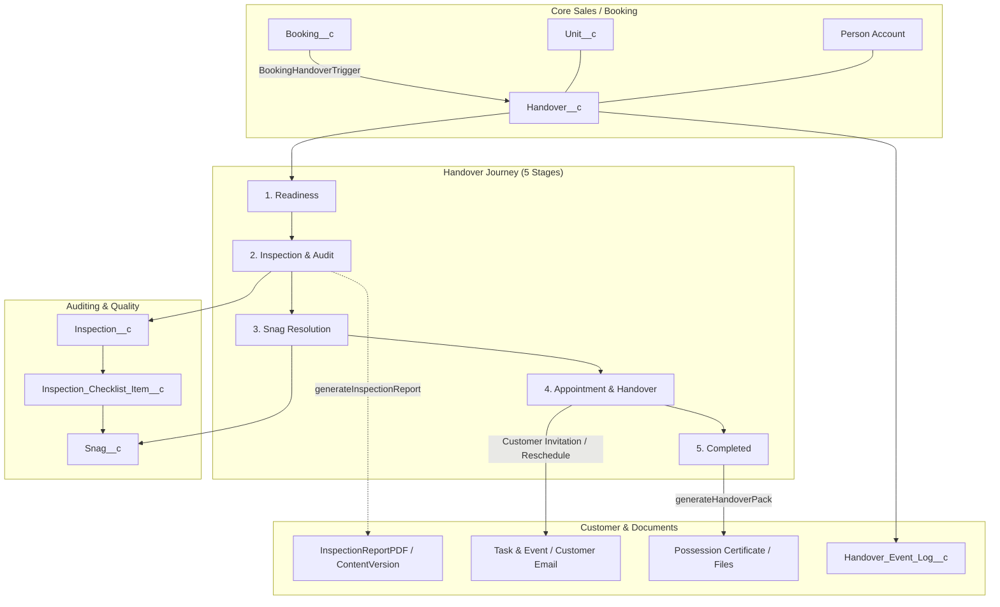

# Residential Handover — Technical Architecture & Implementation Documentation

This document provides a comprehensive technical overview of the **Salesforce Residential Handover module**, including component responsibilities, state machines, lifecycle progressions, security models, data contracts, and verification procedures.

---

## 1. High-Level Architecture Overview

The Residential Handover module is an enterprise-grade Salesforce solution designed for residential property developers. It manages the post-sale transition of an apartment unit from initial construction clearance through formal key handover and customer possession.



---

## 2. The 5-Stage Handover Journey

The business process is strictly partitioned into 5 sequential stages:

```
[1. Readiness] ➔ [2. Inspection & Audit] ➔ [3. Snag Resolution] ➔ [4. Appointment & Handover] ➔ [5. Completed]
```

### Stage 1: Readiness
- **Objective:** Verify operational readiness across four gates before allowing inspection to commence.
- **Readiness Gates:**
  1. *Booking Clearance:* Confirmed booking, token received, allotment letter issued.
  2. *Financial Clearance:* Principal balance cleared or approved under builder subvention/bank loan.
  3. *Occupancy Clearance (OC):* Project and Tower Occupancy Certificate approved by local development authorities.
  4. *Unit Possession Readiness:* Civil finishing complete, keys available on site.
- **Actions & Controls:**
  - **Edit Target Date:** Configures `Target_Inspection_Date__c` / `Target_Handover_Date__c`.
  - **Start Inspection (`Handover__c.Start_Inspection`):** Located in the record header Dynamic Actions. Validates readiness criteria and initializes `Inspection__c` (Round 1) with seeded checklist items. Moves Handover to `Inspection` stage.

### Stage 2: Inspection & Audit
- **Objective:** Lead auditor and QA team audit every room, fixture, electrical outlet, and surface.
- **Checklist Structure:** Grouped by category (Living & Dining, Bedrooms, Bathrooms, Kitchen, Balconies, Electrical & Plumbing).
- **Checklist Evaluation:**
  - `Pass` — Checkpoint verified in pristine condition.
  - `Issue` — Defect identified; automatically generates or links a `Snag__c` record with priority and location pins.
  - `N/A` — Checkpoint not applicable to this unit configuration.
- **Auditor Token Sharing:** Generates a cryptographically secure token (`External_Token__c`) allowing external third-party auditors to audit on mobile devices via `/externalInspection/*` REST API.
- **Completion Gating:**
  - **Inspection Done (`Handover__c.Inspection_Done`):** Enforces 100% completion rule: Every checklist item must be `Pass` or `N/A`. Items with open or unverified snags block completion until resolved. Sets `Inspection_Status__c = 'Completed'` and locks inspection.
  - **Download Inspection Report (`Handover__c.Download_Inspection_Report`):** Dynamic Action visible strictly after `Inspection_Status__c == 'Completed'`. Generates and downloads signed Visualforce PDF (`InspectionReportPDF`).

### Stage 3: Snag Resolution
- **Objective:** Subcontractors and rectification teams fix all logged defects.
- **Kanban Board Columns:**
  1. `OPEN` — Defect reported, awaiting assignment.
  2. `IN_PROGRESS` — Assigned to contractor team (`Responsible_Team__c`), work actively ongoing.
  3. `VERIFICATION` — Contractor submitted rectification comments and evidence photo URL.
  4. `CLOSED` — QA Lead verified and signed off on rectification.
- **Auto-Sync:** When all snags reach `CLOSED` and are verified, the linked checklist item is automatically updated to `Pass`, enabling seamless inspection sign-off.

### Stage 4: Appointment & Handover
- **Objective:** Coordinate the physical handover ceremony with the customer.
- **Dual-State Dynamic Action Workflow:**
  - **State A (Before Invitation Dispatched):**
    - `Customer_Notification_Sent__c == false`
    - Header shows **Invite Customer** (`variant="brand"`).
    - Card inputs (`Appointment Date`, `Time Slot`, `Location`, `Customer Instructions`) are editable.
    - Clicking **Invite Customer** triggers `scheduleAppointment`: dispatches email notification with directions, generates calendar event, and stamps `Customer_Notification_Sent__c = true`.
  - **State B (After Invitation Dispatched):**
    - `Customer_Notification_Sent__c == true`
    - Header hides "Invite Customer" and displays **Reschedule** (`variant="neutral"`).
    - Card appointment inputs are frozen (`disabled={isAppointmentDateDisabled}`) to prevent unnotified direct edits.
    - Clicking **Reschedule** opens the modal dialog, increments `Rescheduled_Count__c`, updates appointment details, and dispatches the revised customer notification.

### Stage 5: Completed
- **Objective:** Execute physical handover ceremony, record final meter readings, hand over keys/cards, and certify possession.
- **Form Inputs:**
  - Keys Handed Over: Number of physical keysets (`Keys_Sets_Count__c`).
  - Access Cards Handed Over: Number of RFID smart cards (`Access_Cards_Count__c`).
  - Meter Readings: Electricity (`Electricity_Meter_Reading__c`), Water (`Water_Meter_Reading__c`), Gas (`Gas_Meter_Reading__c`).
  - Signee Name: Customer signee name capturing the person receiving possession.
  - Feedback Rating: 1 to 5 star rating (`Feedback_Rating__c`) and customer remarks.
- **Automated Outputs:**
  - Invokes `HandoverDocumentGenerator.generateHandoverPack()`.
  - Generates Official Possession Certificate and Keys Handover Document as Salesforce Files (`ContentVersion`).
  - Updates `Handover__c.Stage__c = 'Completed'`, `Status__c = 'Completed'`, and `Completed_Date_Time__c = System.now()`.
  - Logs `Handover_Event_Log__c` completion event and closes open tasks.

---

## 3. Data Model & Field Relationships

### `Handover__c` (Master)
| Field API Name | Type | Description |
|---|---|---|
| `Booking__c` | Lookup (`Booking__c`) | Parent customer booking |
| `Unit__c` | Lookup (`Unit__c`) | Associated apartment unit |
| `Property__c` | Lookup (`Property__c`) | Parent project |
| `Tower__c` | Lookup (`Tower__c`) | Associated tower/block |
| `Customer__c` | Lookup (`Account`) | Residential purchaser (Person Account) |
| `Contact__c` | Lookup (`Contact`) | Purchaser Person Contact ID |
| `Handover_Owner__c` | Lookup (`User`) | Internal relationship manager / handover executive |
| `Stage__c` | Picklist | `Readiness`, `Inspection`, `Resolution`, `Appointment`, `Completed` |
| `Status__c` | Picklist | `Readiness In Progress`, `Inspection In Progress`, `Handover Ready`, `Appointment Scheduled`, `Completed` |
| `Inspection_Status__c` | Picklist | `Not Started`, `In Progress`, `Completed` |
| `Target_Handover_Date__c` | Date | Target possession completion deadline |
| `Customer_Notification_Sent__c` | Checkbox | Indicates whether customer appointment invitation has been dispatched |
| `Customer_Notification_Sent_Date__c`| DateTime | Timestamp of invitation dispatch |
| `Rescheduled_Count__c` | Number(3,0) | Counter tracking how many times the appointment was rescheduled |
| `Keys_Handed_Over__c` | Checkbox | Physical keys confirmation |
| `Keys_Sets_Count__c` | Number(2,0) | Number of keysets issued |
| `Access_Cards_Handed_Over__c` | Checkbox | RFID access cards confirmation |
| `Access_Cards_Count__c` | Number(2,0) | Number of access cards issued |
| `Electricity_Meter_Reading__c` | Text(50) | Initial electricity meter reading |
| `Water_Meter_Reading__c` | Text(50) | Initial water meter reading |
| `Customer_Signee_Name__c` | Text(100) | Formal signee receiving physical unit |
| `Feedback_Rating__c` | Picklist | `1`, `2`, `3`, `4`, `5` star satisfaction score |

### `Inspection__c`
- `Handover__c` (Master-Detail / Lookup to `Handover__c`)
- `Inspection_Round__c` (Picklist: `Round 1`, `Round 2`, `Round 3`)
- `Inspection_Type__c` (Picklist: `Internal`, `Customer Joint`, `Snag Re-inspection`)
- `Status__c` (Picklist: `Scheduled`, `In Progress`, `Completed`, `Cancelled`)
- `Inspector_Name__c`, `Inspector_Company__c`, `Inspector_Email__c` (Auditor credentials)
- `External_Token__c` (Text 64, Unique) — Cryptographic SHA-256 access token
- `Token_Expiry__c` (DateTime) — 7-day token expiration
- `Passed_Items_Count__c`, `Issue_Items_Count__c`, `NA_Items_Count__c`, `Total_Items_Count__c` (Rollup/Count fields)

### `Inspection_Checklist_Item__c`
- `Inspection__c` (Master-Detail / Lookup to `Inspection__c`)
- `Category__c` (Picklist: Living, Bedrooms, Bathrooms, Kitchen, Balconies, Electrical, Plumbing)
- `Result__c` (Picklist: `Pass`, `Issue`, `N/A`)
- `Location_Pin__c` (Text 100) — Pin reference on architectural floorplan
- `Comments__c` (Text 255) — Auditor observations

### `Snag__c`
- `Handover__c` (Lookup to `Handover__c`)
- `Inspection__c` (Lookup to `Inspection__c`)
- `Checklist_Item__c` (Lookup to `Inspection_Checklist_Item__c`)
- `Severity__c` (Picklist: `Critical`, `Major`, `Minor`)
- `Status__c` (Picklist: `Open`, `In Progress`, `Under Verification`, `Closed`, `Rejected`)
- `Responsible_Team__c` (Picklist: Civil, Electrical, Plumbing, Carpentry, Painting, Cleaning)
- `Assigned_Contractor_Name__c` (Text 100)
- `Evidence_URL__c` (URL) — Image upload proof of rectification
- `Due_Date__c`, `Resolved_Date__c`, `Closed_Date__c` (SLA tracking)

### `Handover_Event_Log__c`
- `Handover__c` (Lookup to `Handover__c`)
- `Event_Type__c` (Text 100) — E.g., `Inspection Started`, `Snag Raised`, `Appointment Scheduled`, `Handover Completed`
- `Actor_Name__c` (Text 100) — User or third-party entity who triggered the action
- `Channel__c` (Picklist: `Internal UI`, `Customer Portal`, `External REST API`, `System Automated`)
- `Timestamp__c` (DateTime)

---

## 4. Frontend Component Architecture & State Management

### 4.1 Lightning Data Service & Cache Invalidation
Whenever an action occurs in a quick action modal (such as starting an inspection, completing an audit, scheduling an appointment, or verifying a snag):
1. The Apex method executes within a transaction and updates the record.
2. The modal JS calls `await notifyRecordUpdateAvailable([{ recordId: this._recordId }])`.
3. This invalidates the Lightning Data Service (LDS) client cache for `Handover__c`.
4. Salesforce Dynamic Actions on `Handover_Record_Page` automatically re-evaluate their visibility rules in real-time without requiring a full browser reload.

### 4.2 Cross-Component Event Bus
The primary workspace and quick actions communicate across DOM boundaries via the custom window event `handoverstagechange`:
```javascript
window.dispatchEvent(new CustomEvent('handoverstagechange', {
    detail: { stage: targetStage, recordId: this.recordId }
}));
```
`handoverWorkspace` registers a listener in `connectedCallback` and cleans up in `disconnectedCallback`:
```javascript
this.stageChangeListener = (event) => {
    if (event.detail && event.detail.recordId === this.recordId && event.detail.stage) {
        this.currentActiveStage = event.detail.stage;
        this.loadWorkspace();
    }
};
window.addEventListener('handoverstagechange', this.stageChangeListener);
```

---

## 5. External Auditor REST API (`/externalInspection/*`)

Third-party QA auditors who do not possess Salesforce internal licenses access unit audits via the `ExternalInspectionService` REST API.

- **GET `/services/apexrest/externalInspection/{token}`**
  - Validates token authenticity and expiration (`Token_Expiry__c > System.now()`).
  - Returns `InspectionViewDTO` containing project name, unit number, inspection round, auditor details, and list of `ChecklistItemDTO`.
- **POST `/services/apexrest/externalInspection/`**
  - Accepts `SubmissionPayload` containing updated checklist results, auditor notes, and photo references.
  - Updates checklist items, raises snags for `Issue` items, and records `Handover_Event_Log__c` audit entries with `Channel__c = 'External REST API'`.

---

## 6. Apex Test Suite & Verification Results

All tests are implemented in `HandoverWorkspaceControllerTest` and `InspectionReportPDFControllerTest`.

```
TEST RESULTS:
HandoverWorkspaceControllerTest.testBookingTriggerAndHandoverInitialization      Pass
HandoverWorkspaceControllerTest.testExternalInspectionService                    Pass
HandoverWorkspaceControllerTest.testHandoverWorkspaceLifecycle                   Pass
HandoverWorkspaceControllerTest.testInspectionCompletionAndProceedToAppointment  Pass
HandoverWorkspaceControllerTest.testStartInspectionGatingAndNoDuplicates         Pass
HandoverWorkspaceControllerTest.testTargetedEnhancementsAndRelatedLists          Pass
HandoverWorkspaceControllerTest.testTargetedFunctionalCorrections                Pass
HandoverWorkspaceControllerTest.testTargetedSnagLifecycleAndAppointment          Pass
InspectionReportPDFControllerTest.testInspectionReportWithHandoverId             Pass
InspectionReportPDFControllerTest.testInspectionReportWithInspectionId           Pass
InspectionReportPDFControllerTest.testInspectionReportWithNullId                 Pass

SUMMARY: 11/11 Passed (100% Pass Rate) | Test Run ID: 707Va00002tISn9
```
